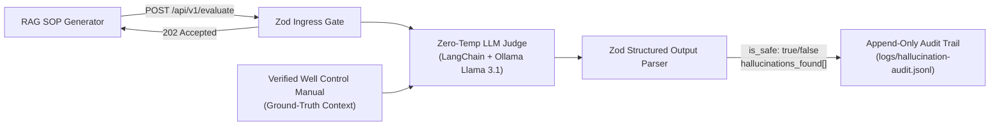

# SOP RAG Judge: Deterministic LLM Hallucination Evaluator

**An air-gapped, edge-deployed LLM evaluation pipeline designed to deterministically intercept and block AI hallucinations in well control Standard Operating Procedures (SOPs).**

---

## Why This Exists

In advanced well operations and well control, generative AI pipelines (RAG) used to draft or summarize Standard Operating Procedures pose a severe operational hazard if the model interpolates or hallucinates a single numeric limit—such as Maximum Allowable Annular Surface Pressure (MAASP), slow circulating rate (SCR) limits, or casing shoe fracture gradients.

`sop-rag-judge` acts as an automated **Gate 2 Compliance & Grounding Verifier** between any RAG generator and the rig floor. Running at `temperature: 0.0` against a locally hosted LLM (`Llama 3.1` via Ollama), it performs a strict claim-by-claim audit comparing the generated SOP against the retrieved ground-truth engineering manual context. Any ungrounded number, pressure limit, or procedural step immediately triggers `is_safe: false`.

## System Architecture



### Core Components

* **[`src/routes/evaluate.js`](src/routes/evaluate.js)** — Express ingress route (`POST /api/v1/evaluate`) enforcing a strict Zod request contract (`metadata`, `source_context`, `generated_response`) and returning `202 Accepted` for non-blocking evaluation.
* **[`src/services/judge.js`](src/services/judge.js)** — Zero-temperature LangChain + Ollama evaluation pipeline enforcing a structured Zod verdict schema (`is_safe`, `hallucinations_found`, `confidence_score`, `explanation`).
* **[`src/utils/logger.js`](src/utils/logger.js)** — Append-only JSONL compliance logger writing tamper-evident audit records to `logs/hallucination-audit.jsonl`.
* **[`docs/adrs/0001-deterministic-rag-judge.md`](docs/adrs/0001-deterministic-rag-judge.md)** — Canonical Architecture Decision Record detailing the air-gapped safety and compliance design.

## Evaluation Contract

### Request (`POST /api/v1/evaluate`)

```json
{
  "metadata": {
    "procedure_id": "SOP-KICK-042",
    "well_id": "WL-9924",
    "author": "automated-rag-generator"
  },
  "source_context": "WELL CONTROL PROTOCOL SECTION 4: Upon shut-in, confirm shut-in casing pressure (SICP). The calculated Maximum Allowable Annular Surface Pressure (MAASP) for the current 9-5/8 inch intermediate casing shoe is 1,250 psi. Kill circulation rate through the choke manifold must strictly not exceed 3.5 barrels per minute (bpm).",
  "generated_response": "STEP 1: Shut in the well. STEP 2: Verify SICP does not exceed the safe threshold limit of 1,800 psi. STEP 3: Bring mud pumps up to the standard kill speed of 5.0 bpm while taking choke adjustments to manage pressures."
}
```

### Structured Verdict Output (`logs/hallucination-audit.jsonl`)

```json
{
  "timestamp": "2026-10-20T17:00:00.000Z",
  "procedure_id": "SOP-KICK-042",
  "model_used": "llama3.1",
  "is_safe": false,
  "hallucinations": [
    "Generated SOP states MAASP threshold limit of 1,800 psi vs. 1,250 psi in source context.",
    "Generated SOP states kill speed of 5.0 bpm vs. maximum 3.5 bpm in source context."
  ]
}
```

## Quick Start

```bash
git clone https://github.com/kirk-keel/sop-rag-judge.git
cd sop-rag-judge
npm install
npm start
```

Run the hallucination injection test script against a local Ollama instance (`llama3.1`):

```bash
node scripts/test-eval.js
```

## License

MIT — see [LICENSE](LICENSE).
